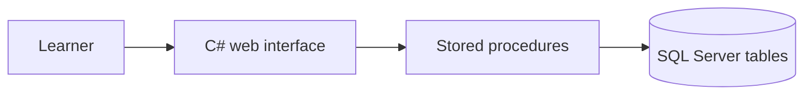

# Language Learning Assistant with Individual Progress Tracking

## 1. Actors and permissions
| Role | Needs | Responsibility / access |
| --- | --- | --- |
| Learner | Practice English vocabulary and see personal progress | Starts practice sessions, answers exercises, views own progress |
| Administrator | Maintain the learning content | Adds and updates words, meanings, example sentences, topics, and difficulty levels |

## 2. Use cases / user stories
### Run a practice session and record answers
- **Actor:** Learner
- **Precondition:** The learner is identified in the application and the database contains learning items.
- **Main flow:**
  1. The learner starts a new practice session.
  2. The interface asks the database to select the next items; the database-side procedure calculates priorities and returns the practice sequence.
  3. The system shows the first exercise.
  4. The learner submits an answer.
  5. The system records whether the answer was correct, the time of the answer, and updates the learner's state for that item.
  6. The system shows feedback and the next exercise until the session ends.
- **Alternative / error flows:** If no item is due for review, the database selects items based on past accuracy. If an answer is empty or invalid, the system rejects it and keeps the exercise open.
- **Postcondition:** All answers and the updated learning states are stored.

### View learning progress
- **Actor:** Learner
- **Precondition:** The learner has at least one completed practice session.
- **Main flow:**
  1. The learner opens the progress page.
  2. The system shows accuracy over time, performance by topic, and the most difficult items.
- **Alternative / error flows:** If there is no practice history, the system shows a message that no data is available yet.
- **Postcondition:** No data is changed.

### Manage learning content
- **Actor:** Administrator
- **Precondition:** The administrator can access the content management function.
- **Main flow:**
  1. The administrator adds or edits a word, its meaning, example sentences, topic, and difficulty level.
  2. The system validates the data and stores it.
- **Alternative / error flows:** If required data is missing or a word already exists, the system rejects the change with an error message.
- **Postcondition:** The learning content is updated and available for new practice sessions.

## 3. Functional requirements
| Requirement | Acceptance criteria | Priority |
| --- | --- | --- |
| The database selects the next practice items. | Given a learner's history, when a session starts, then a database stored procedure returns the practice sequence and the interface does not choose items itself. | Must |
| The system records every answer. | Given a submitted answer, when it is saved, then the database stores correctness, answer time, and updates the repetition count and last practice time. | Must |
| A wrong answer raises the priority of an item. | Given a word answered incorrectly, when the next session is created, then that word has a higher priority and appears earlier than before. | Must |
| A correct answer lowers the priority of an item. | Given a word answered correctly, when the learning state is updated, then its priority decreases and its review interval increases. | Must |
| Two selection strategies are available. | Given a learner, when a strategy is chosen, then the system can select items using a rule-based method or a weighted-priority method. | Must |
| The database uses at least 10 related tables in 3NF. | Given the final schema, when it is reviewed, then it has at least 10 tables with keys, referential integrity, and uniqueness constraints. | Must |
| The learner can view progress. | Given practice history, when the learner opens the progress page, then accuracy over time and results by topic are shown. | Must |
| The system works with large data. | Given at least 50,000 stored answers, when a session is requested, then the practice sequence is generated in under 1 second.  | Must |
| The administrator can manage learning content. | Given valid data, when the administrator saves it, then the word and its details are stored. | Should |
| The learner can filter practice by topic. | Given a selected topic, when a session starts, then only items from that topic are selected. | Could |

Priority: **Must** = required for the final product; **Should** = important; **Could** = optional if time permits.

## 4. Business rules and constraints
| Rule or constraint | Rationale |
| --- | --- |
| The selection logic runs only in the database (T-SQL stored procedures or functions). | Keeps the core logic central and reusable by any interface. |
| An incorrect answer raises the priority of the item, so it is practiced again sooner. | Weak items need more repetition. |
| A correct answer lowers the priority and increases the review interval. | Well-known items should appear less often. |
| Priority also increases after a long period without practice, and depends on item difficulty. | Prevents forgetting and gives harder items more attention. |
| The database enforces keys, referential integrity, unique constraints, and valid values. | Keeps the data consistent regardless of the interface. |
| Invalid or incomplete input is rejected and does not change the learning state. | Protects the learning history. |

## 5. User interface and workflow
The application has three main screens: a start screen where the learner begins a session, a practice screen that shows one exercise at a time with feedback, and a progress screen with accuracy statistics. The interface only displays exercises and sends answers. It does not decide which items are practiced next.

## 6. Non-functional requirements
| Requirement | How it will be verified |
| --- | --- |
| Generating a practice sequence takes under 1 second with at least 50,000 stored answers. | Execution time measured on generated test data. | 
| At least five complex queries are optimized. | Results before and after indexing are compared using execution plans and `SET STATISTICS IO/TIME`. |
| Test data generation is reproducible. | The same script produces the same dataset on a new database. |
| The system can be installed from the repository. | Setup steps are documented and tested on a clean database. |

## 7. Open questions and risks
| Question / risk | Impact | Owner | Resolution / decision |
| --- | --- | --- | --- |
| How should the learner be identified without a full login system? | Affects the data model and interface | Student | Start with simple user selection; add accounts only if required. |
| The priority formula may select poor items. | Affects learning quality | Student | Compare two strategies on test data and adjust the weights. |
| Sequence generation may be slow with large histories. | Affects usability | Student | Measure against the 1-second target, add indexes, and optimize queries. |

## 8. Initial technical specification proposal
### Proposed solution
The system has a Microsoft SQL Server database that stores users, words, meanings, example sentences, topics, difficulty levels, practice sessions, exercises, answers, and learning states. T-SQL stored procedures calculate item priorities and return the next practice sequence. A simple C# web interface calls these procedures and displays exercises and progress.

### Technology direction
| Area | Candidate technology / approach | Reason for consideration | Open question / risk |
| --- | --- | --- | --- |
| Database | Microsoft SQL Server with T-SQL | Provides procedural logic and execution-plan tools | Version and local setup must be chosen. |
| Interface | C# web application | Matches my experience and keeps the interface simple | Framework must be selected. |
| Performance analysis | Actual Execution Plan, `SET STATISTICS IO/TIME` | Required for query optimization | Needs large generated test data. |
| Version control | Git and GitHub | Traceable history | None. |

### Initial architecture sketch

### Feasibility and technical risks
| Risk / assumption | Validation planned for semester 2 | Fallback approach |
| --- | --- | --- |
| The weighted-priority formula gives a useful practice order. | Compare it with the simple rule-based strategy on test data. | Adjust weights or use the rule-based strategy. |
| Tens of thousands of answers can be processed quickly. | Measure execution time and execution plans. | Add indexes or simplify the calculation. |
